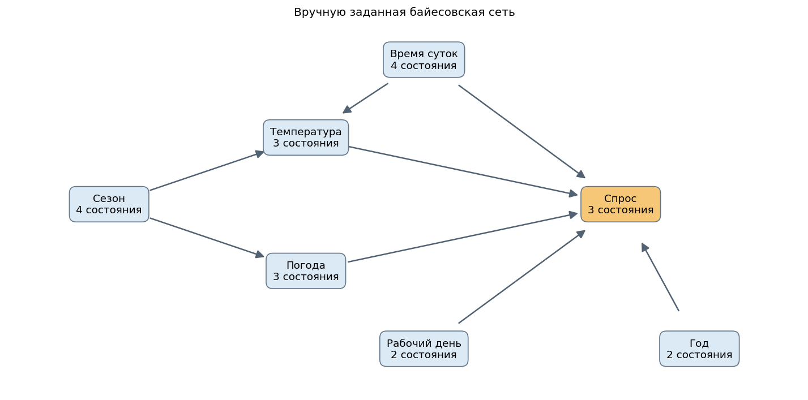

# Лабораторная работа №4: байесовская сеть

Решение: **[lab04_bayesian_network.ipynb](lab04_bayesian_network.ipynb)**.
Ноутбук выполнен; таблицы, графики и интерпретации сохранены внутри.

Данные — [UCI Bike Sharing](https://archive.ics.uci.edu/dataset/275/bike+sharing+dataset):
17 379 зарегистрированных часов аренды велосипедов за 2011–2012 годы.
Данные включены локально, интернет при запуске не нужен.

## Что выполнено

- Описание объекта и признаков, проверка пропусков, дубликатов и отсутствующих часов.
- Обоснованная дискретизация и объединение редкой категории погоды.
- Четыре содержательных вопроса, сформулированных до построения сети.
- Ручной DAG из 7 вершин и 8 рёбер с объяснением направления каждой связи.
- CPT со сглаживанием Дирихле, анализ наполненности и сверка с исходными частотами.
- Четыре точных вероятностных запроса и сравнение до/после evidence.
- Шесть последовательных состояний знания о спросе, таблица и график.
- Удаление `weather → demand`, переоценка параметров и повторный запрос.
- Разбор причинности, условных независимостей, необычных результатов и ограничений.
- Дополнительно — чувствительность к сглаживанию и проверки алгоритма вывода.

## Запуск

Зависимости зафиксированы по использованной среде Python 3.14.3.
Из корня репозитория:

```powershell
python -m pip install -r bayesian/requirements.txt
python -X utf8 bayesian/run_notebook.py
```

Либо откройте ноутбук в Jupyter / VS Code и выберите **Run All**.
Рабочая директория может быть корнем репозитория или `bayesian/`.
Повторный запуск обновляет выводы ноутбука и файлы `results/`.
Вычисления детерминированы: случайные выборки и Monte Carlo не используются.

Проверки реализации:

```powershell
python -m unittest discover -s bayesian -p test_bayes.py -v
```

## Основные результаты

| Запрос | До evidence | После evidence |
|---|---:|---:|
| Высокий спрос при тепле | 22,98% | 40,60% |
| Высокий спрос при тепле и осадках | 22,98% | 32,50% |
| Высокий спрос днём в рабочий день | 22,98% | 29,51% |
| Тепло при известном высоком спросе | 25,47% | 45,01% |

После удаления `weather → demand` второй запрос даёт **42,31%**, изменение **+9,82 п.п.**
У CPT спроса 144 конфигурации родителей: одна пустая, 27 содержат менее 20 наблюдений.
Поэтому общий объём данных не гарантирует надёжности каждого сценария.



## Файлы

| Файл | Назначение |
|---|---|
| `lab04_bayesian_network.ipynb` | Полный отчёт, исполняемый код и результаты |
| `bayes.py` | CPT и точный вывод по совместному распределению из 1 728 состояний |
| `test_bayes.py` | Шесть тестов: ручной расчёт, ненаблюдавшиеся состояния, ошибки, независимость, коллайдер |
| `run_notebook.py` | Запуск в новом ядре и сохранение выводов |
| `data/` | Исходные данные, авторское описание, источник и лицензия |
| `results/summary.md` | Численные итоги |
| `results/cpt_*.csv` | CPT всех переменных и наполненность конфигураций |
| `results/queries.csv` | Ответы сети, эмпирические частоты и размеры групп |
| `results/evidence_experiment.csv` | Последовательное накопление evidence |
| `results/structure_comparison.csv` | Сравнение исходной и сокращённой сети |
| `results/smoothing_sensitivity.csv` | Чувствительность к α |
| `results/*.png` | Пять графиков, также встроенных в ноутбук |
| `results/run_manifest.json` | Структура, состояния, пороги, версии и SHA-256 данных |

## Границы выводов

Модель описывает историческую выборку; все параметры оценены по всем наблюдениям.
Сравнение с частотами этой же выборки не является проверкой прогноза. Для прогнозной
задачи нужны временной holdout, baseline и проверка калибровки. Стрелки и условные
вероятности сами по себе не доказывают причинность; интервенционные запросы не выполняются.
