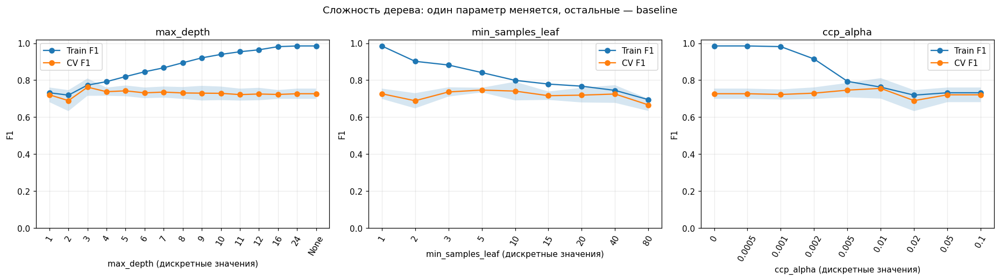

# Лабораторная работа №3: оптимизация гиперпараметров

Решение: [lab03_hyperparameters.ipynb](lab03_hyperparameters.ipynb).
Задача из №2 — предсказание выживаемости пассажиров Titanic; модель — дерево решений.
Основная метрика — F1 для выживших. Baseline повторяет исходное неограниченное дерево `dt_full` из №2.

## Содержание

- Фиксация исходных параметров и качества baseline.
- Объяснение трёх параметров: `max_depth`, `min_samples_leaf`, `ccp_alpha`.
- Стратифицированная 5-fold CV на train и ответы на вопросы о корректности подбора.
- Grid Search и Random Search: по 96 кандидатов и 480 CV-обучений, измеренные времена.
- Кривые train/CV для трёх параметров с разбросом по folds.
- Выбор решения по CV до тестовой оценки, сравнение baseline и двух победителей.
- Отдельные folds, анализ устойчивости, выводы и ограничения.

## Запуск

Зависимости зафиксированы по среде выполненного ноутбука (Python 3.14.3):

```powershell
python -m pip install -r hyperparameters/requirements.txt
```

Откройте ноутбук в Jupyter или VS Code и выполните **Run All**. Допустима рабочая директория
как в корне репозитория, так и в `hyperparameters`: путь к локальному датасету определяется автоматически.
Скачивание данных не требуется.

Для исполнения и сохранения всех выводов из корня репозитория без графического интерфейса:

```powershell
python -X utf8 -c "from pathlib import Path; import nbformat; from nbclient import NotebookClient; p=Path('hyperparameters/lab03_hyperparameters.ipynb'); n=nbformat.read(p,as_version=4); NotebookClient(n,timeout=600,kernel_name='python3',resources={'metadata':{'path':str(p.parent.resolve())}}).execute(); nbformat.write(n,p)"
```

Seed всех случайных этапов — 42. Поиски выполняются последовательно с `n_jobs=1`;
их время включает CV и вычисление метрик, но не финальное переобучение.
Повторный запуск перезаписывает таблицы и графики в `results/`; время может измениться.

## Результаты сохранённого запуска

| Модель | CV F1 | std по folds | Test F1 | Время поиска |
|---|---:|---:|---:|---:|
| Baseline | 0.7262 | 0.0279 | 0.7338 | — |
| Grid Search | **0.7619** | 0.0469 | **0.7692** | 7.04 с |
| Random Search | 0.7594 | 0.0307 | 0.6667 | 7.24 с |

По CV выбран **Grid Search**: `max_depth=3`, `min_samples_leaf=1`, `ccp_alpha=0`.
Прирост F1 относительно baseline: **+0.0357 по CV**, **+0.0354 по test**.
Random Search: `max_depth=None`, `min_samples_leaf=3`, `ccp_alpha=0.0035`;
улучшение CV (+0.0332) не подтвердилось на test (−0.0671). Выбор по test не пересматривался.
У Grid выше среднее CV, но и выше разброс; эти два свойства нужно оценивать отдельно.



## Сохранённые материалы

| Файл в `results/` | Содержимое |
|---|---|
| `summary.md` | Численные итоги и условные максимумы кривых |
| `model_comparison.csv` | CV, test, train, изменения относительно baseline, размер финальных деревьев |
| `search_summary.csv` | Бюджеты, лучшие параметры, CV и время обеих стратегий |
| `grid_cv_results.csv`, `random_cv_results.csv` | Все кандидаты, оценки train/validation по folds, средние, разброс и времена |
| `fold_scores.csv`, `stability.csv` | Пять оценок трёх моделей, среднее, std, min/max и размах |
| `validation_curves.csv` | Значения трёх диагностических кривых |
| `validation_curves.png`, `fold_scores.png`, `model_comparison.png` | Графики, также встроенные в ноутбук |
| `selection_before_test.json` | Выбор до test, пространства, параметры, индексы train/test и folds, версии, SHA-256 данных |
| `test_predictions.csv` | Однократно полученные тестовые прогнозы трёх финальных моделей |

## Честность эксперимента

Препроцессинг обучается внутри `Pipeline` отдельно в каждом fold. Данные test не передаются
в поиск или диагностические кривые. Победитель фиксируется по среднему CV F1, после чего
все три модели обучаются на всём train и оцениваются на test. Лидер по test не меняет выбор.

Сохраняется разбиение №2 (712 train / 179 test). Этот test уже оценивался в предыдущей работе,
поэтому он не является новым независимым набором. Лучший CV score также подвержен оптимизму
выбора среди кандидатов. Эти ограничения и возможная зависимость пассажиров одной семьи
разобраны в ноутбуке; результаты не выдаются за доказательство превосходства стратегии поиска.
